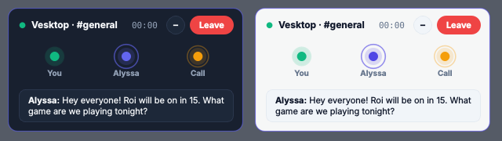

<div align="center">


# ✨ Alyssa ✨

**Your slightly chaotic desktop companion who actually gets stuff done.**

Say her name, ask for anything, and she'll open your apps, hop into your Discord
call, clip your sick play, or roast your RAM usage. 🎧💬🖥️


[Meet her](#-meet-alyssa) •
[What she can do](#-what-she-can-do) •
[Get started](#-get-started) •
[Talk to her](#-things-to-say) •
[Plugins](#-plugins) •
[Safety](#-before-you-hand-over-the-keys)

</div>

---

## 👋 Meet Alyssa

Alyssa is a voice assistant I built for my own Windows desktop. She listens
for her name, transcribes your speech locally with Faster Whisper, and hands
anything that needs real thinking to whichever LLM you've plugged in (Gemini
by default, but Ollama, OpenAI, Anthropic, or any OpenAI‑compatible endpoint
all work).

She lives on your screen as a little companion who can wander along your
window edges, ride your cursor, play mini‑games with you, and chat in a soft
Nanami voice. 🌸

> 🧪 **This is a personal project, not a product.** Expect a few rough edges.
> I'm sharing it because it's been genuinely useful (and fun) for me.

---

## 🎀 What she can do

| | |
| --- | --- |
| 🗣️ **Wake word** | Just say *"Alyssa"* (she also answers to a pile of mishearings like *Alisa* or *Elyssa*). A little chime tells you she's listening. |
| 🧠 **Swappable brain** | Gemini, Ollama, OpenAI, Anthropic, or a custom endpoint. Pick in Settings. |
| 🎙️ **Fast, smooth speech** | Local Whisper (or ElevenLabs realtime) in, streamed Edge or ElevenLabs voice out, with no awkward gaps between sentences or between steps of a multi‑step command. |
| 🖱️ **Runs your PC** | Apps, windows, media, clipboard, files, screenshots, typing, and system stats. |
| 👀 **Sees your screen** | "What am I looking at?", click things by description, or `watch_for` something and get pinged when it shows up. |
| 📞 **Joins your calls** | Discord *and Vesktop*, Zoom, Teams, WhatsApp, Steam. She asks which server and voice channel, then hops in. [More below ⬇️](#-call-mode) |
| 🎮 **Game co‑pilot** | Spots what you're playing, remembers your keybinds, shows a floating HUD, and **"clip that!"** saves the last 30 seconds to `Videos/Alyssa/`. |
| 🕹️ **She plays for you** | Say *"play this for me"* and she watches the game window and presses the keys herself, about one move every couple of seconds. Great for turn‑based, puzzle, card and strategy games; slow at shooters. Press **F8** or say *"stop playing"* to take back control. She refuses games with anti‑cheat (Valorant, Fortnite, CS2, Roblox, ...) so your account stays safe. |
| 🍿 **Watch‑along** | "Watch this with me" and she'll react to videos and streams (sparingly, she has manners). |
| ✏️ **Screen ink & mini‑games** | She can draw arrows and circles right on your screen, or play tic‑tac‑toe, Connect Four, rock paper scissors, or chess. |
| 📝 **Remembers stuff** | Facts across sessions, reminders, timers, and sticky notes. |
| 🤖 **Coding buddy** | Coding buddy mode shows live status for Claude Code, Codex, and OpenCode sessions. |
| 🃏 **Pranks** | A harmless 5‑second fake blue screen and a swarm of cheeky clones. Turn off with `DESKTOP_CHAOS_ENABLED = False` if you're no fun. 😜 |
| 🛡️ **Safety presets** | Ask always, Careful, Balanced, or Autopilot. You decide how much she's allowed to touch. |

---

## 📞 Call mode



### 🎧 Her own Discord bot (best)

She joins your voice channel as **her own bot account** and talks there. You don't need a virtual mic,
and she doesn't touch your Discord window.

1. Go to [discord.com/developers/applications](https://discord.com/developers/applications) and make
   a **New Application**. Then open **Bot** and press **Reset Token**, and copy the token.
2. In Settings, turn on **Discord Bot**, paste the token, and add **your Discord user ID**. To copy
   your ID, turn on Discord > Settings > Advanced > Developer Mode, then right-click your name and
   pick **Copy User ID**.
3. Settings now shows an **"Add her to a server"** link. Open it and pick your server. It only asks
   for *Connect* and *Speak*.
4. Get in a voice channel and say *"Alyssa, join my Discord call."* She finds the channel you're in
   and hops in.

- *"tell them I'm joining in ten minutes"* passes your message on word for word.
- When she joins she **says hi to everyone there by name**, and she greets people who join later.
- Friends can talk to her too. She replies when they **say her name**, or when they answer her right
  after she spoke (a couple of times, then they need her name again), so the call doesn't eat your
  AI quota.
- If a friend asks her to open a game or play a song, she **asks you first**. Say *"yes"* or *"no"*.
- *"leave the call"* makes her disconnect. She also leaves by herself a minute after everyone else has.

**How she hears your friends:**
- **By default she uses your PC's audio**, so stay in the call yourself. She can't tell people apart
  that way, and she can hear game sounds. She listens to your **Windows default output device**, so
  Discord has to play through that one (the log says which device she's listening to).
- **Bot ears (optional, experimental):** she hears each friend separately through her own
  connection. This needs a community voice-receive add-on that can decode Discord's encrypted voice,
  and it isn't installed automatically. It's for source installs only, not the .exe:
  `pip install "git+https://github.com/zacker150/discord-ext-voice-recv@dcf543a1618d6212f10db5d5dbb7a45f76a955e9"`.
  If the bot ever stops hearing anything while your PC clearly does, she switches back to the PC's
  audio by herself.

### Without the bot

- Works with **Discord and Vesktop**, plus Zoom, Teams, WhatsApp, Steam, and browser calls.
- Say *"Alyssa, join my Discord call"* and she'll ask **which server and voice channel**. Then she
  jumps there with Discord's quick switcher (**Ctrl+K**).
- Her voice reaches the call through a virtual mic (`CABLE Input` by default; set
  `CALL_VIRTUAL_MIC_DEVICE` if yours is different). In Discord, set your input device to
  **CABLE Output**.

---

## 🚀 Get started

### The easy way 🍰

Grab **`Alyssa-Setup.exe`** from the
[latest release](https://github.com/r9risky/alyssa-assistant/releases/latest)
and run it. No admin rights needed; she installs just for you, adds a Start
menu entry, and walks you through picking her brain, mic and voice the first
time she starts. She keeps herself updated from the Updates tab in Settings.

> Windows SmartScreen may say it "protected your PC" because the installer
> isn't code-signed yet. Click **More info → Run anyway**.

Prefer no installer? `Alyssa-Windows-x64.zip` from the same release works
too: unzip it and run `Alyssa.exe`.

### From source 🛠️

You'll need:

- Windows 10 or 11
- Python 3.10+ from [python.org](https://www.python.org/downloads/)
- A mic and speakers 🎤🔊
- At least one LLM provider
- [Microsoft C++ Build Tools](https://visualstudio.microsoft.com/visual-cpp-build-tools/)
  *only* if a package has no prebuilt wheel for your Python (looking at you,
  `webrtcvad-wheels`)

Then:

1. Clone this repo.
2. Optional: set `WHISPER_DEVICE = "cpu"` in `config.py` if you don't want a
   few gigs of NVIDIA packages.
3. Double‑click `scripts\start_alyssa.bat`. ✨

That script builds a `.venv`, installs everything, and starts her. Later
launches reuse it unless a requirements file changed.

<details>
<summary>Prefer doing it by hand?</summary>

```powershell
python -m venv .venv
.venv\Scripts\python -m pip install -r requirements.txt
.venv\Scripts\python main.py
```

If `WHISPER_DEVICE` is `auto` or `cuda`, also install `requirements-gpu.txt`.

</details>

### 🧠 Pick a brain

Set it in Settings, or `LLM_PROVIDER` in `config.py`:

| Value | Provider | What it needs |
| --- | --- | --- |
| `gemini` | Google Gemini (default) | A Gemini key |
| `ollama` | Local Ollama model | Ollama running, `OLLAMA_MODEL` pulled |
| `openai` | OpenAI | An OpenAI key |
| `anthropic` | Anthropic | An Anthropic key |
| `custom_openai` | Any OpenAI‑compatible endpoint | Base URL, model, optional key |

Want everything local? Install [Ollama](https://ollama.com/) and run
`ollama pull qwen2.5:3b` (plus `llava` for vision).

Keys you enter in Settings go straight into your OS keyring, never a file.
Environment variables also work and win over the keyring:

```powershell
setx GEMINI_API_KEY "your-key"
setx OPENAI_API_KEY "your-key"
setx ANTHROPIC_API_KEY "your-key"
setx CUSTOM_LLM_API_KEY "your-key"
```

(Restart your terminal or Alyssa after `setx`.)

---

## 💬 Things to say

```text
Alyssa, open Spotify and play something chill
Alyssa, join my Discord call
Alyssa, tell them I'm joining in ten minutes
Alyssa, clip that!
Alyssa, what am I looking at?
Alyssa, tell me when the download finishes
Alyssa, watch this video with me
Alyssa, let's play tic-tac-toe
Alyssa, come here / ride my cursor / go wander
Alyssa, remind me to call the dentist tomorrow at 3 PM
Alyssa, what's eating all my memory?
Alyssa, summarize https://example.com/article
```

*"Alyssa, stop"* cuts her off mid‑sentence. Typed messages in the companion
window don't need her name first.

### ⌨️ Hotkeys

| Keys | Does |
| --- | --- |
| `Ctrl+Alt+V` | Push to talk |
| `Ctrl+Alt+T` | Type to her |
| `Ctrl+Alt+N` | Mute the mic |
| `Ctrl+Alt+P` | Quiet mode |
| `Ctrl+Alt+H` | Hide or show her |
| `Ctrl+Alt+C` | Hop off your cursor |

---

## 🛡️ Before you hand over the keys

Alyssa can type, click, run commands, and move files, basically anything a
person at your keyboard can do. So she comes with **safety presets**
(`SECURITY_PRESET`, also in Settings):

| Preset | Vibe |
| --- | --- |
| 🔒 `ask_always` | Asks before *everything*. |
| 🧸 `careful` | Media, clipboard, and screen reading only. |
| 🤝 `balanced` *(default)* | Apps, windows, media, typing. Still asks before clicking, deleting, shell commands, or power actions. |
| 🔥 `autopilot` | Never asks. You've been warned. |

A few more honest notes:

- She ignores audio without her name. That audio is still transcribed
  *locally* to check, but it isn't acted on or sent anywhere.
- Saying "yes" is not a security boundary. Anyone near the mic can approve a
  pending action.
- Deleted files go to the Recycle Bin, not oblivion. 🗑️
- Your cloud LLM sees your prompts (and screenshots if you use vision). Edge
  TTS sends her reply text to Microsoft to turn into audio.
- API keys live in your OS keyring (Windows Credential Manager, macOS
  Keychain, or Linux Secret Service). Old plaintext keys in `config.py` get
  migrated and blanked automatically.
- `memory.json`, Google OAuth files, and tokens are gitignored. Don't commit
  them.

None of this makes her safe to run unsupervised. It just puts a speed bump
in front of the obvious footguns. 🦶🔫

---

## 🧩 Plugins

Everything in `plugins/` loads at startup. Here's the gang:

| Plugin | What it does |
| --- | --- |
| 📞 `call_mode` | Join and talk in Discord, Vesktop, Zoom, Teams, and more |
| 🎮 `game_copilot` | Game detection, keybind memory, HUD, "clip that" |
| 🕹️ `game_autoplay` | Alyssa plays the game herself (see, decide, press keys) |
| 🍿 `watch_along` | React to videos and streams with you |
| ✏️ `mini_games_and_ink` | Screen drawing and mini‑games |
| 👀 `screen_lookout` | `watch_for` alerts and gentle check‑ins |
| 🚶 `companion_life` | Come here, ride the cursor, wander |
| 🃏 `desktop_chaos` | Fake BSOD and clone swarm pranks |
| 🤖 `code_husk_mode` | Live companion for coding agents |
| 📌 `sticky_notes` | Voice sticky notes, with their own Settings tab |
| ⏰ `reminders`, `timers` | Reminders, timers, stopwatch |
| 🌦️ `weather`, `location` | Open‑Meteo weather from your IP location |
| 🔎 `web_search`, `web_summarizer`, `news_digest` | Search, summaries, news |
| 📅 `calendar_gmail` | Read‑only Google Calendar and Gmail |
| 🧮 `calculator_converter` | Math and unit conversion |
| 🩺 `system_watch`, `process_manager` | System health and process control |
| 📷 `security_camera` | Optional webcam motion alerts |
| 🦴 `caveman_mode`, `ponytail_mode` | Shorter, punchier replies |

Some need extra credentials or hardware. The docstring at the top of each
file explains setup and what it sends where.

### 🛠️ Make your own

A plugin is just a `.py` file in `plugins/` that exports `FUNCTIONS` and a
matching `TOOLS` schema. Files starting with `_` are skipped.

```python
def roll_die(sides: int = 6) -> str:
    import random
    return str(random.randint(1, sides))


FUNCTIONS = {"roll_die": roll_die}

TOOLS = [
    {
        "type": "function",
        "function": {
            "name": "roll_die",
            "description": "Rolls a die.",
            "parameters": {
                "type": "object",
                "properties": {"sides": {"type": "integer", "minimum": 2}},
            },
        },
    }
]
```

Add `check_watch() -> str | None` (plus an optional `WATCH_INTERVAL_SECONDS`)
if you want her to speak up on her own. 🎲 Quiet mode mutes these, unless the
plugin sets `ANNOUNCE_IN_QUIET_MODE = True` (timers and the focus timer do,
because you asked for them).

Two more hooks keep a plugin cheap on tokens:

- `INSTANT_REPLY_TOOLS = {"roll_die"}` means the tool's return value is already
  the whole reply, so she says it as is and skips the second model call that
  would only reword it. If the request has several steps ("roll a die and
  then..."), or the tool fails, she still goes back to the model.
- `handle_intent(cleaned, text) -> str | None` answers fixed phrases before any
  model call. `cleaned` is the request lowercased, without "hey Alyssa" or
  "please". Return the reply, or `None` to let the model handle it.

```python
def handle_intent(cleaned, text=""):
    if cleaned in {"roll a die", "roll the dice"}:
        return f"You rolled a {roll_die()}."
    return None
```

Say what your plugin needs with `PERMISSIONS = ["network", "files"]` (choices:
`network`, `files`, `keyboard_mouse`, `screen`, `microphone`, `camera`, `shell`,
`background`). A plugin that didn't come with Alyssa stays off until you approve
it in **Settings → Plugins** (🟡 in the list), and asks again if an update wants
more. Plugins you create or save in that editor count as approved.

A plugin that lists its `PERMISSIONS` runs in its own process and is held to
them: no internet without `network`, no programs without `shell`, no native code
without a device permission, and no files outside `plugins/data/<name>/` without
`files`. It never sees Alyssa's memory, settings or API keys, and a hung or
crashing plugin can't freeze her. A plugin with no `PERMISSIONS` list asks to do
anything and, once approved, runs inside Alyssa like the built-in ones (that's
also the only way to get a Settings tab). The limits stop mistakes and casual
misuse; they aren't a guarantee against a determined attacker, so still only
approve code you trust.

**Plugin gallery:** Settings → Plugins → 🧩 Browse Gallery lists extra plugins
(`gallery/` in this repo), shows what each needs, and installs it in one click.
Downloads are checked against the sha256 in `gallery/index.json`. To add one, drop
the file in `gallery/plugins/` and run `python scripts/build_gallery_index.py`.

<details>
<summary>Give your plugin its own Settings tab</summary>

Define `GUI_PANEL_TITLE` and `build_gui_panel` (returns any PySide6
`QWidget`):

```python
from PySide6.QtWidgets import QWidget, QVBoxLayout, QLabel, QPushButton

GUI_PANEL_TITLE = "Dice"


def build_gui_panel(parent):
    # `parent` is the Settings dialog; parent._t() returns its theme dict.
    w = QWidget()
    layout = QVBoxLayout(w)
    result = QLabel("Roll to see a result.")
    layout.addWidget(result)
    roll_btn = QPushButton("Roll a d6")
    roll_btn.clicked.connect(lambda: result.setText(f"You rolled: {roll_die()}"))
    layout.addWidget(roll_btn)
    layout.addStretch(1)
    return w
```

The tab appears after the built‑in ones and updates the moment the plugin is
saved, toggled, or deleted in Settings > Plugins, no restart needed. If
`build_gui_panel` raises, you get a small inline error tab instead of a
broken Settings window. Set `GUI_PANEL_SCROLLABLE = False` if your panel
handles its own scrolling. The "+ New Plugin" template includes a
commented‑out example.

</details>

---

## ⚙️ config.py cheat sheet

<details>
<summary>The settings I touch most</summary>

| Setting | What it does |
| --- | --- |
| `ASSISTANT_NAME` | The wake word (`Alyssa`) |
| `LLM_PROVIDER` | Which brain is active |
| `EDGE_TTS_VOICE` | Her voice (`ja-JP-NanamiNeural`) |
| `SECURITY_PRESET` | `ask_always`, `careful`, `balanced`, or `autopilot` (older names still work) |
| `CONFIRM_BEFORE_ACTIONS` | Force a "yes" for every action |
| `WHISPER_MODEL_SIZE` / `WHISPER_DEVICE` | STT model and `cpu` / `cuda` / `auto` |
| `STT_PROVIDER` | `auto`, `local` Whisper, `groq`, or `elevenlabs_realtime` |
| `TTS_PROVIDER` | `edge` or `elevenlabs` |
| `SILENCE_SECONDS` | How long a pause means you're done |
| `ALLOW_INTERRUPTIONS` / `BARGE_IN_REQUIRE_NAME` | Whether and how you can talk over her |
| `CALL_APP` / `CALL_VIRTUAL_MIC_DEVICE` | Call mode app and virtual mic |
| `DESKTOP_CHAOS_ENABLED` | Pranks on or off |
| `WATCH_ALONG_ENABLED` / `REPLAY_BUFFER_ENABLED` / `GAME_COPILOT_ENABLED` / `MINI_GAMES_ENABLED` | Feature switches |
| `HOTKEYS_ENABLED` | Global hotkeys on or off |
| `PLUGINS_ENABLED` | Load `plugins/` at all |
| `ENABLE_COMPANION_GUI` | Show or hide the desktop companion |

Most of these are in the Settings window too. The Updates tab pulls the
latest GitHub release and overwrites app files (keeping your settings and
data), so back up any code you've tweaked first.

</details>

<details>
<summary>⚡ On latency</summary>

Endpointing defaults to a 300ms window that adapts between 240 and 420ms
based on how fast you talk. Speech has to run 120ms before it counts, and
barge‑in detection kicks in after 150ms. With name‑gated interruption on,
playback only stops once the audio has both her name and "stop" in it.

With an ElevenLabs key, `STT_PROVIDER = "auto"` uses Scribe realtime over a
persistent WebSocket with partial transcripts. No key falls back to local
Whisper. Text streams from every provider, and generation, TTS, playback,
and interruption listening all overlap. Typed messages interrupt instantly.

</details>

<details>
<summary>🏗️ How it's laid out</summary>

Stacked on purpose so nothing imports in a circle:

```text
main.py / overlay
        |
        v
brain (dialogue, providers, vision)
        |
        v
actions (desktop/system adapters) ----> plugin_loader ----> plugins
        |
        v
OS / audio / network
```

- `brain/dialogue.py` owns the conversation loop.
- `brain/tool_catalog.py` / `brain/tool_registry.py` own tool schemas, so
  providers never import orchestration code.
- `actions/desktop.py` keeps PyAutoGUI out of the reasoning layer, and
  `actions/bridges.py` injects the bits `actions` needs from `brain`.
- `audio/` holds recording, VAD, transcription, speech synthesis, playback,
  DSP, wake word, and call audio. `core/` holds the keyring, logging,
  telemetry, name matching, hotkeys, and memory.
- Root shims (`recorder.py`, `voice.py`, `memory.py`, etc.) keep old imports
  working.

</details>

<details>
<summary>💾 What's stored locally</summary>

| File | What's in it |
| --- | --- |
| `memory.json` | Facts she's been told to remember |
| `reminders.json` | Reminders |
| `sticky_notes.json` | Sticky notes |
| `token.json` | Google OAuth token, if that plugin is on |
| `overlay_config.json` | Companion position and look |

API keys are in the OS keyring, not here. Session chat history lives in
memory and expires after the configured timeout.

</details>

---

## 🧪 Running the tests

```powershell
.venv\Scripts\python -m pip install -r requirements-dev.txt
.venv\Scripts\python -m pytest
```

## 🌅 Launch on startup

`scripts\install_startup.bat` adds her to Task Scheduler and
`scripts\uninstall_startup.bat` removes her. Both run with your normal user
rights; Alyssa never asks for admin. Read the script first, and only do this
once you're happy with what she's allowed to do unattended.

---

## 🩹 When something's broken

- **Python isn't found:** reinstall from python.org and tick "Add Python to
  PATH".
- **Setup seems stuck:** delete `.venv` and rerun `scripts\start_alyssa.bat`.
- **Can't reach Ollama:** make sure it's running and `ollama list` shows your
  model.
- **Cloud provider is silent:** double‑check the key and model in Settings.
- **She interrupts herself on background noise:** keep
  `BARGE_IN_REQUIRE_NAME = True`, or try a headset instead of speakers.
- **She can't hear the call / the call can't hear her:** check that a virtual
  audio cable is installed and `CALL_VIRTUAL_MIC_DEVICE` matches its name.
- **A plugin didn't load:** check the startup console. Import errors print
  there, and the other plugins keep loading.

---

<div align="center">

Made with 💜, too much coffee, and a lot of *"Alyssa, stop."*

</div>
